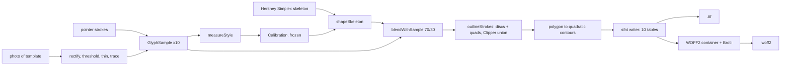

# Architecture

One page. Everything runs in the browser; there is no server.

## Modules

**`src/core`** is pure TypeScript with no DOM.

- `hershey.ts` parses the JHF skeleton font into strokes in font units (em 1000, baseline 0, y up).
- `measure.ts` turns drawn letters into a `StyleProfile`: slant (mode of upright stroke directions), pen width, x-height ratio, roundness (superellipse exponent fitted to bowls), wobble (spread of baselines), width, terminal.
- `deform.ts` bends a skeleton glyph by a profile in a fixed order (round, x-height, width and bearings, wobble, slant), and blends a drawn letter in at 70 percent when its strokes can be paired with the skeleton's.
- `outline.ts` expands centrelines into filled contours and chooses on-curve and off-curve points.
- `build.ts` ties it together. `buildGlyph(char, skeleton, calibration, sample)` depends on nothing else, which is the "redraw one letter, change one glyph" guarantee.

**`src/font`** writes bytes. `sfnt.ts` builds `OS/2 cmap glyf head hhea hmtx loca maxp name post` and the table directory with checksums. `woff2.ts` wraps the same tables with untransformed `glyf` and `loca`, compressed by Node's zlib, by `brotli-wasm` in a browser, or by a stored-block Brotli stream if neither loads.

**`src/raster`** recovers strokes from pixels: Otsu threshold, Zhang-Suen thinning, a skeleton tracer that rejoins branches through junctions, and the template pipeline (find four registration squares, solve a homography, rectify each cell, threshold against that cell's own paper white).

**`src/ui`** is React. `App.tsx` holds samples, the frozen calibration and the current font; `DrawCell.tsx` converts pointer events to font units on arrival.

## Invariants

- Samples are stored in font units, so canvas size and device pixel ratio never reach the pipeline.
- The calibration freezes when the tenth letter lands. After that only "Re-measure" or a slider changes it.
- Equal input gives byte-equal fonts: no clock (the `head` timestamp is a constant), seeded noise, stable contour order.
- A glyph's outline coordinates are integers before they reach the font writer.

## Checked by

Four parsers that share no code with the writer: opentype.js (in the unit tests), fontTools (`scripts/validate_font.py`), macOS CoreText (`scripts/coretext-check.swift`), and Chromium's sanitizer through `FontFace` (`scripts/check-browser.ts`).

## Decisions worth knowing

- The PRD names opentype.js as the generator. It can only write CFF outlines, so a `.ttf` from it would be an OpenType-CFF file with the wrong extension. The writer here is hand-rolled, and opentype.js is kept as a validator.
- Outlining by unioning discs and quads is slower than offsetting a path and has no special cases. Export still takes about 100 ms.
- The skeleton is Hershey Roman Simplex (see `vendor/hershey`), used under its own permissive terms.
