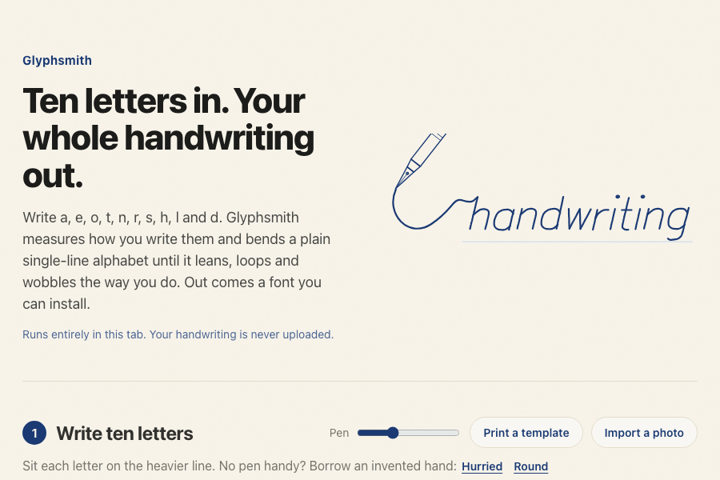
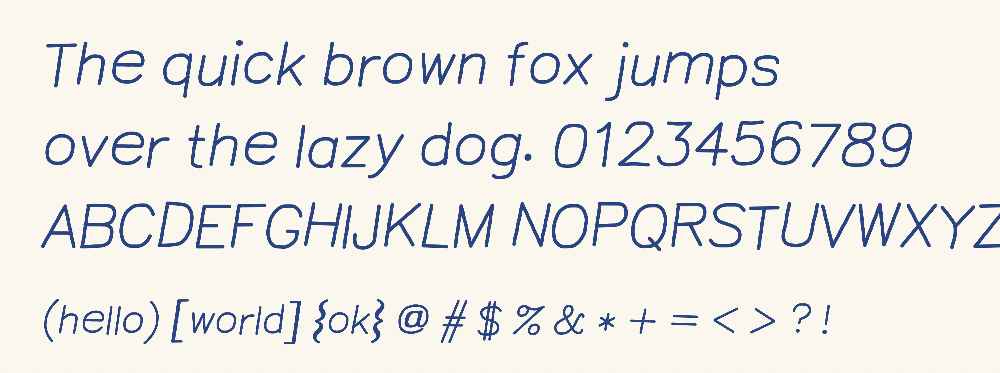
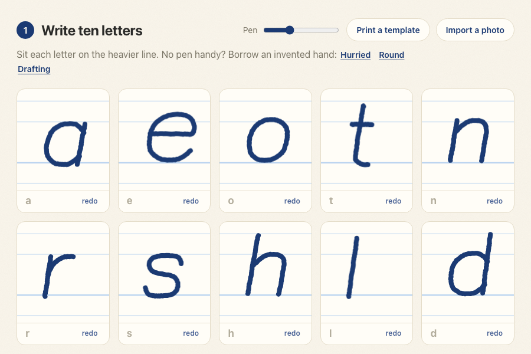
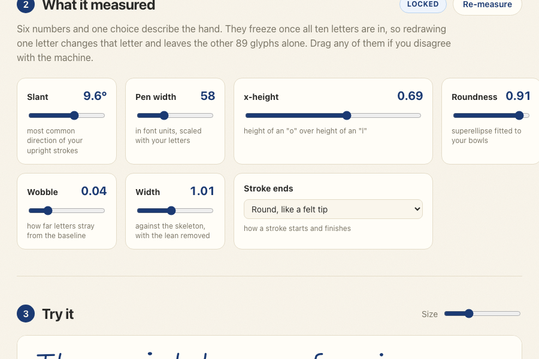
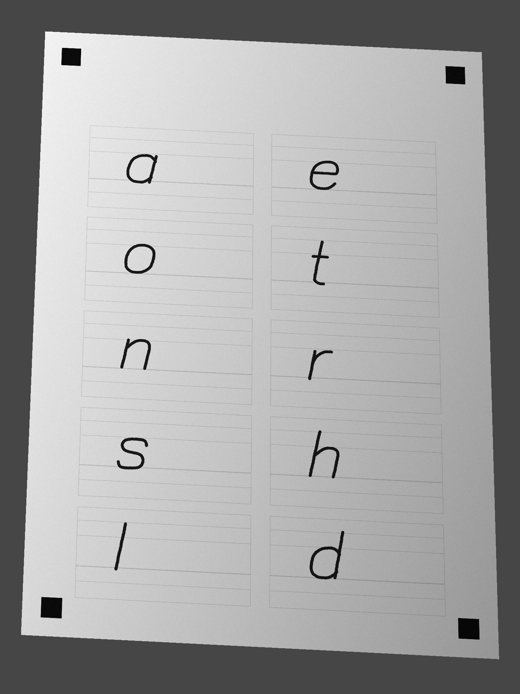
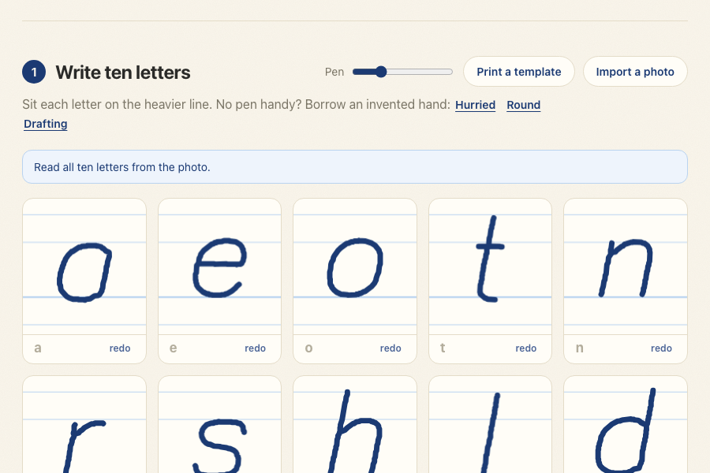
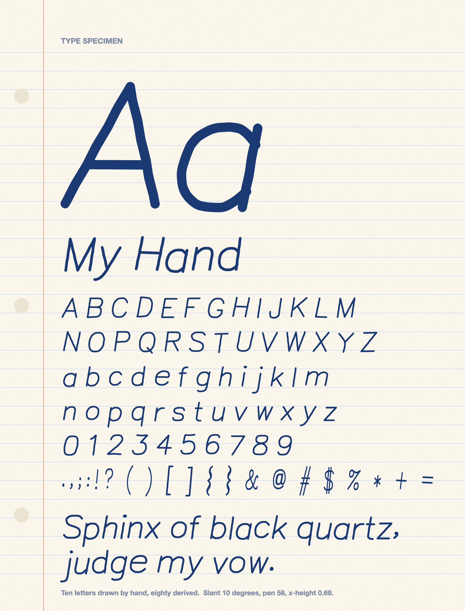
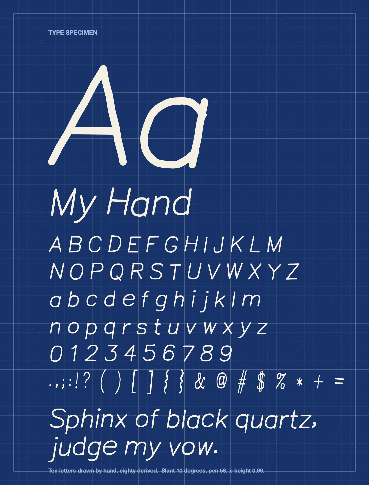
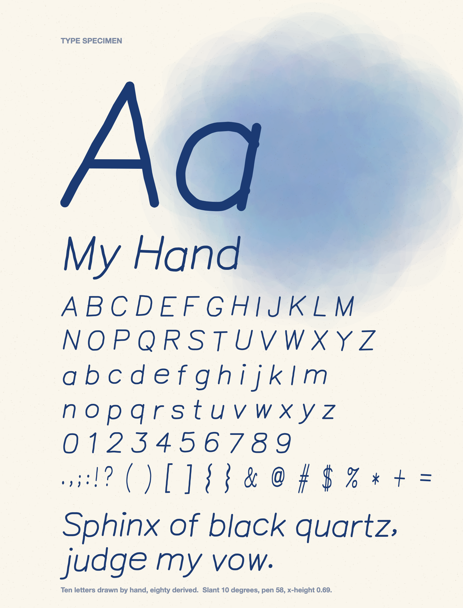

<div align="center">

# Glyphsmith

### ten letters in, your whole handwriting out

[](tsconfig.json)
[](#run-it)
[](tests)
[](LICENSE)

<br>



</div>

<br>

You write ten letters: a, e, o, t, n, r, s, h, l, d. Glyphsmith works out how far your writing leans, how round you make an "o", how high your small letters stand against your tall ones, and how badly you stray from the line. Then it takes a plain single-stroke alphabet and bends every letter of it by those same amounts. A fraction of a second later there is a `.ttf` in your downloads folder that types like you.

All of it happens in the browser tab. There is no server to send your handwriting to, which settles the privacy question by leaving nobody to trust.

<p align="center"></p>
<p align="center"><sub>The font the demo above exported, set by CoreText, the text engine behind every native macOS app.</sub></p>

<br>

## Table of contents

- [Run it](#run-it)
- [How ten letters become ninety](#how-ten-letters-become-ninety)
- [What it measures](#what-it-measures)
- [The parts that fought back](#the-parts-that-fought-back)
- [From a photo](#from-a-photo)
- [Acceptance tests](#acceptance-tests)
- [Limitations](#limitations)
- [Next](#next)
- [Layout and credits](#layout-and-credits)

<br>

## Run it

```bash
git clone https://github.com/ayaan-gupta/glyphsmith && cd glyphsmith && npm install && npm run dev
```

Open http://localhost:4102 and draw. If you have no pen or patience, the page offers to lend you an invented hand.

`npm run build` produces a static site in `dist/` that can sit on any file host.

<br>

## How ten letters become ninety

Ten samples cannot be stretched into ninety glyphs by drawing, so the samples are used as evidence instead.

1. **Capture.** Pointer positions are converted to font units the moment they arrive. Nothing downstream ever learns how big the canvas was.
2. **Measure.** The ten letters are boiled down to six numbers and one choice. That is the whole model of your hand.
3. **Bend.** Each of the 90 glyphs starts as a centreline from Hershey Roman Simplex, an alphabet from 1967 made for machines that drew with a single moving point. Its strokes are rounded or squared, rescaled, widened, jostled and finally slanted to match the measurement.
4. **Blend.** For the ten letters you did draw, your strokes are mixed with the bent skeleton at 70 to 30 in your favour.
5. **Outline and write.** Centrelines are fattened into shapes with your pen width, converted to quadratic curves, and packed into a TrueType file.

<p align="center">
  
  
</p>

Step four has a catch that took me a while to respect. Blending means averaging matching points, and that only makes sense when the strokes correspond. Glyphsmith tries every pairing of your strokes with the skeleton's, in both directions, since people do not agree on where an "h" starts. If the best pairing is still far apart, or you built the letter from a different number of strokes, it gives up on blending and uses your letter exactly as drawn. Averaging a one-stroke "a" with a two-stroke "a" produces a letter nobody wrote.

<br>

## What it measures

| | How | Why this way |
|---|---|---|
| **Slant** | The most common direction among roughly upright stroke segments | See below. A mean gets this wrong |
| **Pen width** | The pen setting, or the distance transform when reading a photo | Scaled with your letters, so small writing keeps its proportions |
| **x-height** | Median top of a, e, o, n, r, s over median top of h, l, d | Medians shrug off one overgrown letter |
| **Roundness** | Exponent of a superellipse fitted to your closed bowls | Separates a round hand from a boxy one in a single number |
| **Wobble** | Standard deviation of where letters sit, over x-height | Reapplied per glyph with seeded noise, so it is repeatable |
| **Width** | Bounding boxes against the skeleton's, with the lean removed first | Otherwise an italic reads as a wide hand |
| **Stroke ends** | Round, flat or tapered | Chosen by you, or inferred from how ink thins in a photo |

The demo at the top is a fair test of this. The letters in it were written by a script moving a real mouse pointer through an invented hand, so the truth is known. Here is what the page read off those strokes:

| | True | Measured |
|---|---|---|
| Slant | 9 degrees | 9.6 |
| x-height | 0.68 | 0.69 |
| Roundness | 0.90 | 0.91 |
| Width | 1.02 | 1.01 |
| Wobble | 0.035 | 0.04 |

<br>

## The parts that fought back

### The spec said opentype.js. opentype.js cannot write a .ttf.

It writes CFF outlines only. A file from it is an OpenType-CFF font, and naming that `.ttf` would be a small lie that happens to install. So the font writer here is by hand: ten tables, the directory, the checksums, and glyph coordinates stored as deltas that take zero, one or two bytes depending on their size. It lives in [`sfnt.ts`](src/font/sfnt.ts) and runs to about 280 lines.

Trusting my own parser to check my own writer would prove little, so four programs that share no code with it read every export:

| Reader | What a pass means |
|---|---|
| opentype.js | A JavaScript parser finds 92 glyphs, a working cmap and non-empty outlines |
| fontTools | Python decompiles every table, then recompiles the font without complaint |
| macOS CoreText | The engine behind Font Book maps all 90 characters to glyphs with ink in them |
| Chromium | The browser's font sanitizer accepts the TTF and the WOFF2 through `FontFace` |

opentype.js kept its place in the project after all, as the first of those.

### A curve with no points on it

TrueType curves are quadratic, and the format has a quirk I had read about and never used. If a contour lists two control points in a row, the rasteriser assumes an on-curve point halfway between them. Follow that to its end and a smooth shape can be written as control points alone.

The outliner produces polygons. Any vertex that turns gently and sits between short edges is emitted as a control point, so the renderer draws a spline through the midpoints of the polygon's edges and the facets disappear at every size. Sharp vertices stay on the curve and remain corners. A whole font comes to roughly 9,000 points and 29 KB.

### Slant is a mode

My first instinct was to average the direction of every near-vertical segment. That works for an "l". An "o" contributes segments at every angle, though, and once the writing leans, a fixed window around vertical clips them unevenly and drags the average back toward zero.

Stems are straight, so their segments pile up at one angle. Taking the peak of a smoothed histogram finds that pile and ignores the bowls. On ten letters built from lines and arcs, with no help from the skeleton font, a true slant of 12 degrees reads as 12.01.

### The roundness estimator that measured nothing

Version one walked each stroke and asked what share of its turning happened gradually. I generated hands across the full range of roundness and measured them. The score went from 0.967 to 0.977. It moved in the right direction and could not tell any two hands apart.

The replacement fits a superellipse, the family `|x|^n + |y|^n = 1`, to each closed bowl. At n = 2 that is an ellipse. Push n higher and the curve swells toward a box. Only points near the diagonals vote on the exponent, since along the axes every n draws the same curve. The same exponent then drives the bending, which is why what gets measured can be handed straight back to the skeleton: a hand generated at 0.1, 0.5 and 0.9 reads back within 0.2 of each.

### "Redrawing one letter updates only that glyph"

I underestimated this acceptance test. It reads like a note about the interface, and it ended up deciding how the whole pipeline is wired. The style is measured from all ten letters. Redraw your "e", re-measure, and the slant shifts by a fraction of a degree, which moves every one of the other 89 glyphs.

So the measurement freezes the moment the tenth letter lands. `buildGlyph` takes the frozen calibration, one skeleton glyph and one sample, and has no access to anything else. The test rebuilds the font after altering an "e" and compares the encoded bytes of all 92 glyphs. Exactly one differs. There is a Re-measure button for when you do want the other behaviour.

### Two bugs the tests could not see

Every letter was meant to sit a little high or low by a repeatable amount, seeded from its name. They all moved together. FNV-1a, hashing `dy:a` and `dy:b`, differs only in the final multiply, and one multiply spreads a last-byte difference across about a tenth of the output range. Every letter was getting nearly the same "random" number. Three rounds of a finishing mix fixed it, and measured wobble started tracking the wobble I asked for.

The second one I found by reading my own demo recording. The specimen poster said **My Hanc**. Every "d" had lost its stem and was rendering as a "c". The stem of a "d" starts high on the right of the cell, exactly where I had floated the redo button, and the button was swallowing the first touch. No unit test covers "a button is in the way". The controls now sit under the canvas, and [CLAUDE.md](CLAUDE.md) carries a note about it.

<br>

## From a photo

<p align="center">
  
  &nbsp;&nbsp;
  
</p>

Print the template and write on it, then photograph it at whatever angle the desk allows. The import looks for the four black squares and solves for the projective transform that would put them back where they were printed. Each cell is pulled out of the photo through that transform and thresholded against its own paper white, so a shadow across half the page costs nothing.

Getting from pixels back to pen strokes is the interesting half. Zhang-Suen thinning erodes each blob to a line one pixel wide. That line is a graph. A pixel with two neighbours is part of a path, and anything else is a node: a loose end, or a junction where strokes meet. A "t" arrives as four arms meeting in the middle, which is no use to anyone, so at each junction the two arms that continue each other most directly are rejoined. The result is a stem and a crossbar, the way it was written.

<br>

## Acceptance tests

| Requirement | Result |
|---|---|
| The exported font opens in Font Book and renders all 90 glyphs with no missing-glyph boxes | CoreText loads fonts built from three different hands, plus the one the browser exported, and reports ink in all 90. I have not clicked through Font Book's own window |
| Slant measured from a synthetic 12 degree italic is within 2 degrees | Reads 12.01. Also within 2 at -15, -6, 0, 5, 20 and 30 |
| Redrawing one letter updates only that glyph | Byte comparison across all 92 glyphs: one differs |
| Total export time is under 5 seconds on a laptop | 92 ms in headless Chromium, about 100 ms in Node, both on an M5 Pro. The test fails above 1.5 s |

```bash
npm test
```

64 tests. The CoreText one runs only on macOS and needs `swift` on the path. The fontTools one wants a virtualenv: `python3.12 -m venv .venv && .venv/bin/pip install fonttools brotli`.

<br>

## Limitations

- **Six numbers is not a hand.** The 80 derived glyphs are Hershey's letterforms wearing your proportions. If you write a "g" with a loop where Hershey draws a hook, you get the hook.
- **Monoline only.** Tapered ends are the one variation in stroke width. Pen pressure is recorded by the browser and ignored by me.
- **Never run on Windows.** The PRD asks for a font that installs on macOS and Windows. The file passes fontTools and Chromium's sanitizer, which is encouraging, and I do not own a Windows machine to prove it. There are no hinting instructions, so small sizes there may look rough.
- **The photo import has only seen synthetic photos.** The test image is a rendered sheet pushed through a perspective warp, a lighting gradient and sensor noise. Real ink on real paper under a real phone is untested. The page also has to be roughly upright in the frame.
- **No kerning.** Spacing comes from Hershey's side bearings, tightened to 55 percent and padded by half a pen.
- **Roundness needs closed bowls.** If your a, d and o are all drawn open, the estimator has nothing to fit and falls back to a default.
- **The WOFF2 is larger than it needs to be.** It skips the optional `glyf` transform. Brotli still gets it to 16 KB from 29.
- **The art is interim.** The hero, the three poster backgrounds and the template header are requested in [`assets/prompts.md`](assets/prompts.md) and drawn in code until they arrive.
- **Not deployed.** The demo is a recording.

<br>

## Next

1. **Carry habits between related letters.** How you draw the arch of an "n" says a lot about your "m", "h" and "u". Fitting a warp from the skeleton "n" to yours and applying it to its relatives would make derived letters look less borrowed.
2. **Pressure into contrast.** The outliner already handles a pen that changes width along a stroke, because tapers need it. Feeding it real pressure data is mostly plumbing.
3. **Kerning from the outlines.** Measure the gap between each pair of glyphs at several heights and write a `kern` table from it.

<br>

## Layout and credits

```
src/core/      measurement, skeleton parsing, deformation, blending, outlining
src/font/      the TrueType writer and the WOFF2 container
src/raster/    thresholding, thinning, skeleton tracing, the photographed template
src/ui/        React app: drawing cells, sliders, preview, posters
scripts/       CLI font builder, fontTools and CoreText checks, demo recorder
vendor/hershey the skeleton font and its licence
tests/         64 tests
```

More in [ARCHITECTURE.md](ARCHITECTURE.md).

<p align="center">
  
  
  
</p>

The skeleton alphabet is Hershey Roman Simplex. The Hershey Fonts were originally created by Dr. A. V. Hershey while working at the U.S. National Bureau of Standards, and the JHF format the data ships in was created by James Hurt of Cognition, Inc. Their terms are in [`vendor/hershey/LICENSE`](vendor/hershey/LICENSE).

Everything else is MIT. See [LICENSE](LICENSE).
